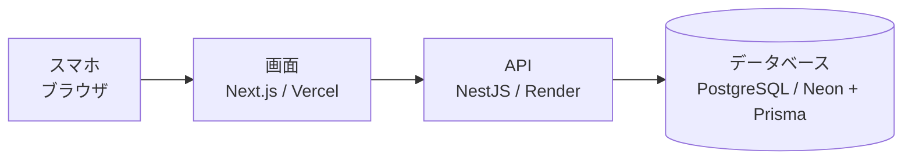

# スロット期待値アプリ 要件定義書

作成日: 2026-10-28

## 1. 概要

スロットの実戦結果をスマホから記録し、狙い目ごとの期待値と成功率を自動で算出するWebアプリを作る。

- **目的**:実戦データから「どの狙い目が本当に勝てるか」を数字で判断できるようにする
- **利用者**:開発者本人のみ(ポートフォリオ閲覧者向けにデモアカウントを用意)
- **利用シーン**:ホールで実戦直後にスマホで記録し、家で分析を見る
- **スコープ**:要件定義 → 設計 → 実装 → テスト → デプロイまでを一通り行う

## 2. 用語定義

| 用語 | 意味 |
| --- | --- |
| 実戦 | 1回の台の打ち始めからヤメまで。1実戦 = 1レコード |
| 機種 | 打った台の機種。ユーザーが事前またはその場で登録する |
| 狙い目 | 機種ごとに登録する打ち始めゲーム数の範囲(例:A機種 180G〜250G) |
| 成功 | その実戦でゾーン当選できたか。ユーザーが成功/失敗を手動で選ぶ |
| 差枚 | 回収枚数 − 投資枚数 |
| 成功率 | 狙い目ごとの 成功回数 ÷ 試行回数 |
| 期待値 | 狙い目ごとの 総回収枚数 ÷ 総投資枚数(単位:倍) |

```latex
	ext{期待値} = \frac{\sum(\text{回収枚数})}{\sum(\text{投資枚数})}
```

## 3. 機能要件

機能は認証・マスタ管理・実戦記録・分析の4グループ、計17項目。初期版(MVP)はすべて必須とする。

| ID | グループ | 機能 | 内容 |
| --- | --- | --- | --- |
| F-01 | 認証 | ログイン | メールアドレスとパスワードでログイン。未ログイン時は全画面にアクセス不可 |
| F-02 | 認証 | ログアウト | ログアウトできる |
| F-03 | 認証 | デモアカウント | ポートフォリオ閲覧者用。サンプルデータ入りで閲覧できる |
| F-04 | 機種 | 機種登録 | 機種名を登録する |
| F-05 | 機種 | 機種編集・削除 | 機種名の変更、削除ができる。削除時は確認ダイアログを出し、紐づく狙い目・実戦記録の件数を表示する。承認すると記録ごと削除する |
| F-06 | 狙い目 | 狙い目登録 | 機種ごとに開始G〜終了Gの範囲で登録する |
| F-07 | 狙い目 | 狙い目編集・削除 | 範囲の変更、削除ができる。削除時は確認ダイアログを出し、紐づく実戦記録の件数を表示する。承認すると記録ごと削除する。同じ機種で範囲が重なる登録も可 |
| F-08 | 記録 | 実戦登録 | 機種と狙い目をリストから選び、結果を入力して保存する |
| F-09 | 記録 | その場で作成 | 記録画面から離れずに、機種・狙い目を新規作成できる |
| F-10 | 記録 | 実戦一覧 | 記録を日付の新しい順に一覧表示する |
| F-11 | 記録 | 実戦編集・削除 | 入力ミスを修正・削除できる |
| F-12 | 分析 | 狙い目別分析 | 狙い目ごとに試行数・成功率・総投資・総回収・差枚・期待値を表示 |
| F-13 | 分析 | 全体集計 | 総試行数・総投資・総回収・トータル差枚・全体期待値を表示 |
| F-14 | 分析 | 機種別比較 | 機種ごとの期待値・成功率を一覧で比較 |
| F-15 | 分析 | 推移グラフ | 日ごとの差枚と累計差枚を折れ線で表示 |
| F-16 | 分析 | 期間絞り込み | 分析対象を期間で絞り込む(今月、先月、任意期間) |
| F-17 | 共通 | 入力チェック | 数値は0以上の整数、回収・投資は必須、など不正値を保存しない |

## 4. データ項目

データは「機種」「狙い目」「実戦」の3つ。成功率・期待値・差枚は保存せず、表示時に計算する。

**機種**

| 項目 | 型 | 必須 | 備考 |
| --- | --- | --- | --- |
| 機種名 | 文字列 | ○ | 同名の重複登録は不可 |

**狙い目**(機種に属する)

| 項目 | 型 | 必須 | 備考 |
| --- | --- | --- | --- |
| 機種 | 機種への参照 | ○ |  |
| 開始G | 整数 | ○ | 0以上 |
| 終了G | 整数 | ○ | 開始G以上 |

**実戦**

| 項目 | 型 | 必須 | 備考 |
| --- | --- | --- | --- |
| 実戦日 | 日付 | ○ | 初期値は今日 |
| 機種 | 機種への参照 | ○ |  |
| 狙い目 | 狙い目への参照 | ○ | 選んだ機種の狙い目から選択 |
| 打ち始めG | 整数 | ○ | 0以上 |
| 回したG数 | 整数 | ○ | 0以上 |
| 投資枚数 | 整数 | ○ | 0以上 |
| 回収枚数 | 整数 | ○ | 0以上 |
| 成功 | 真偽値 | ○ | ゾーン当選の成功/失敗 |
| 店舗名 | 文字列 |  | 自由入力。過去に入力した店舗名を候補表示する |
| メモ | 文字列 |  | 自由入力 |

## 5. 画面一覧

画面は6つ。ホールで最も使う「実戦記録」を、ログイン後の最初の画面にする。

| 画面 | 主な内容 | 関連機能 |
| --- | --- | --- |
| ログイン | メール・パスワード入力、デモログインボタン | F-01, F-03 |
| 実戦記録(ホーム) | 入力フォーム。機種・狙い目の選択と、その場で新規作成 | F-08, F-09 |
| 実戦一覧 | 記録の一覧、各記録の編集・削除 | F-10, F-11 |
| 分析 | 全体集計、機種別比較、狙い目別分析、推移グラフ、期間絞り込み | F-12〜F-16 |
| 機種・狙い目管理 | 機種と狙い目の登録・編集・削除 | F-04〜F-07 |
| 設定 | ログアウト | F-02 |

スマホでは画面下部のタブバーで「記録/一覧/分析/管理」を切り替える。

## 6. 非機能要件

| 分類 | 要件 |
| --- | --- |
| 対応端末 | スマホ優先のレスポンシブ。PCブラウザでも閲覧可能 |
| 操作性 | 1実戦の記録が30秒以内に終わる。数値入力は数字キーボードを出す |
| 通信 | オンライン前提。オフライン記録は対象外 |
| セキュリティ | HTTPS通信、パスワードはハッシュ化して保存、他人のデータは見られない |
| 公開範囲 | URLはあるがログイン必須。新規登録画面は設けない |
| 費用 | 無料枠のサービスで運用する(月0円) |
| 性能 | 1,000件程度の実戦データで分析画面が2秒以内に表示される |

## 7. 技術構成



スマホのブラウザから画面(Next.js)を開き、画面がAPI(NestJS)経由でデータベースを読み書きする。

| 役割 | 技術 | 選定理由 |
| --- | --- | --- |
| 言語 | TypeScript | 全層で統一でき、覚える言語が1つで済む |
| 画面 | Next.js(React) | スマホ対応の画面を作りやすく、求人での需要も高い |
| API | NestJS | 本人希望。構成の型が決まっていて、未経験でも迷いにくい |
| データベース | PostgreSQL + Prisma | 期待値などの集計をしやすく、TypeScriptから型安全に扱える |
| 置き場所 | Vercel / Render / Neon | いずれも無料枠あり |
| テスト・CI | Jest / Playwright / GitHub Actions | 8章を参照 |

Renderの無料プランは、しばらくアクセスがないと停止し、次の起動に数十秒かかることがある。ホールで待たされるのが気になる場合は、後で置き場所を見直す。

## 8. テスト方針

期待値・成功率の計算はアプリの核なので、ここを最も厚くテストする。

| 種類 | 対象 | ツール | 例 |
| --- | --- | --- | --- |
| 単体テスト | 計算ロジック、入力チェック | Jest | 試行0件のとき期待値が「データなし」になる |
| APIテスト | NestJSの各API | Jest + Supertest | 他人の実戦データを取得しようとすると拒否される |
| E2Eテスト | 画面操作の一連の流れ | Playwright | ログイン → 記録 → 分析に反映される |
| 手動テスト | 実機での使い勝手 | 自分のスマホ | ホールで実際に1実戦を30秒以内に記録できる |

テストは GitHub Actions で、コードを push するたびに自動実行する。

## 9. 対象外・決定事項

**初期版の対象外**

- オフラインでの記録(PWA)
- 円換算での期待値表示(枚数のみ)
- 当選ゲーム数からのゾーン成功の自動判定
- 自分以外のユーザーの新規登録

**決定事項**(2026-10-29)

| 論点 | 決定 |
| --- | --- |
| 記録が残っている機種・狙い目の削除 | 確認ダイアログで件数を示し、承認されたら記録ごと削除する |
| 同じ機種での狙い目の範囲の重なり | 許可する |
| 試行回数が少ない狙い目の注意表示 | 出さない |
| 店舗名の入力 | 自由入力+過去の店舗名を候補表示 |
