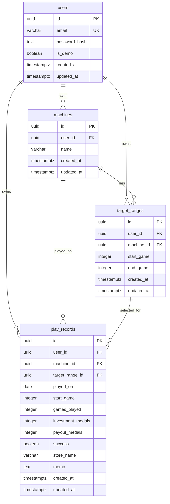

# スロット期待値アプリ テーブル設計書

作成日: 2026-10-29  
参照: [要件定義書](requirements.md)

## 1. 設計方針

- PostgreSQLを使用し、主キーはUUIDとする。
- 認証・データ分離のため`users`を設け、機種・狙い目・実戦の全データをユーザーに紐付ける。
- パスワードは平文で保存せず、アプリケーションで安全なハッシュに変換して`password_hash`へ保存する。
- 差枚・成功率・期待値などの集計値は保存せず、実戦データから都度計算する。
- 機種・狙い目の削除は物理削除とし、関連する子データも外部キーの`ON DELETE CASCADE`で削除する。
- 狙い目の重複・範囲の重なりを許可する。同一機種で範囲が完全一致する狙い目も登録可能とする。

## 2. ER図

## 3. テーブル定義

### 3.1 `users`（ユーザー）

| カラム | PostgreSQL型 | NULL | 制約・初期値 | 説明 |
| --- | --- | --- | --- | --- |
| `id` | `uuid` | NOT NULL | PK、`gen_random_uuid()` | ユーザーID |
| `email` | `varchar(254)` | NOT NULL | UNIQUE | ログイン用メールアドレス。保存前に前後空白を除去し、小文字に正規化する |
| `password_hash` | `text` | NOT NULL |  | パスワードのハッシュ値 |
| `is_demo` | `boolean` | NOT NULL | DEFAULT `false` | デモアカウント識別フラグ |
| `created_at` | `timestamptz` | NOT NULL | DEFAULT `now()` | 作成日時 |
| `updated_at` | `timestamptz` | NOT NULL | DEFAULT `now()` | 更新日時 |

新規登録画面は設けず、通常ユーザーとデモユーザーは初期データ投入などの管理手段で作成する。デモデータも`users`のデモユーザーIDに紐付け、通常ユーザーのデータとは分離する。

### 3.2 `machines`（機種）

| カラム | PostgreSQL型 | NULL | 制約・初期値 | 説明 |
| --- | --- | --- | --- | --- |
| `id` | `uuid` | NOT NULL | PK、`gen_random_uuid()` | 機種ID |
| `user_id` | `uuid` | NOT NULL | FK → `users.id`、ON DELETE CASCADE | 所有ユーザーID |
| `name` | `varchar(100)` | NOT NULL |  | 機種名。保存前に前後空白を除去する |
| `created_at` | `timestamptz` | NOT NULL | DEFAULT `now()` | 作成日時 |
| `updated_at` | `timestamptz` | NOT NULL | DEFAULT `now()` | 更新日時 |

**一意制約**: `(user_id, name)`。同一ユーザー内の同名機種は不可。他ユーザー間では同名を許可する。

### 3.3 `target_ranges`（狙い目）

| カラム | PostgreSQL型 | NULL | 制約・初期値 | 説明 |
| --- | --- | --- | --- | --- |
| `id` | `uuid` | NOT NULL | PK、`gen_random_uuid()` | 狙い目ID |
| `user_id` | `uuid` | NOT NULL | FK → `users.id`、ON DELETE CASCADE | 所有ユーザーID |
| `machine_id` | `uuid` | NOT NULL | FK → `machines.id`、ON DELETE CASCADE | 対象機種ID |
| `start_game` | `integer` | NOT NULL | CHECK `>= 0` | 開始G |
| `end_game` | `integer` | NOT NULL | CHECK `>= start_game` | 終了G |
| `created_at` | `timestamptz` | NOT NULL | DEFAULT `now()` | 作成日時 |
| `updated_at` | `timestamptz` | NOT NULL | DEFAULT `now()` | 更新日時 |

狙い目を選択しやすくするため、範囲表示は`start_game`と`end_game`から生成する。重複範囲を禁止する一意制約は設けない。

### 3.4 `play_records`（実戦記録）

| カラム | PostgreSQL型 | NULL | 制約・初期値 | 説明 |
| --- | --- | --- | --- | --- |
| `id` | `uuid` | NOT NULL | PK、`gen_random_uuid()` | 実戦記録ID |
| `user_id` | `uuid` | NOT NULL | FK → `users.id`、ON DELETE CASCADE | 所有ユーザーID |
| `machine_id` | `uuid` | NOT NULL | FK → `machines.id`、ON DELETE CASCADE | 実戦した機種ID |
| `target_range_id` | `uuid` | NOT NULL | FK → `target_ranges.id`、ON DELETE CASCADE | 選択した狙い目ID |
| `played_on` | `date` | NOT NULL |  | 実戦日。新規登録時の初期値はアプリ側で当日を設定 |
| `start_game` | `integer` | NOT NULL | CHECK `>= 0` | 打ち始めG |
| `games_played` | `integer` | NOT NULL | CHECK `>= 0` | 回したG数 |
| `investment_medals` | `integer` | NOT NULL | CHECK `>= 0` | 投資枚数 |
| `payout_medals` | `integer` | NOT NULL | CHECK `>= 0` | 回収枚数 |
| `success` | `boolean` | NOT NULL |  | ゾーン当選の成否 |
| `store_name` | `varchar(100)` | NULL |  | 店舗名。自由入力 |
| `memo` | `text` | NULL |  | メモ |
| `created_at` | `timestamptz` | NOT NULL | DEFAULT `now()` | 作成日時 |
| `updated_at` | `timestamptz` | NOT NULL | DEFAULT `now()` | 更新日時 |

## 4. リレーションと整合性制約

| 親 → 子 | 制約 | 削除時の動作 |
| --- | --- | --- |
| `users` → `machines` | `machines.user_id` | ユーザー削除時に機種を削除 |
| `users` → `target_ranges` | `target_ranges.user_id` | ユーザー削除時に狙い目を削除 |
| `users` → `play_records` | `play_records.user_id` | ユーザー削除時に実戦を削除 |
| `machines` → `target_ranges` | `target_ranges.machine_id` | 機種削除時に狙い目を削除 |
| `machines` → `play_records` | `play_records.machine_id` | 機種削除時に実戦を削除 |
| `target_ranges` → `play_records` | `play_records.target_range_id` | 狙い目削除時に実戦を削除 |

外部キーは所有者と親子関係の整合性も検査する。具体的には、`machines`に`(id, user_id)`、`target_ranges`に`(id, machine_id, user_id)`の複合UNIQUE制約を設け、次の複合外部キーを設定する。

- `target_ranges (machine_id, user_id)` → `machines (id, user_id)`
- `play_records (machine_id, user_id)` → `machines (id, user_id)`
- `play_records (target_range_id, machine_id, user_id)` → `target_ranges (id, machine_id, user_id)`

これにより、アプリケーションのチェック漏れがあっても、別ユーザーの機種・狙い目や、選択機種と異なる機種の狙い目を関連付けられない。Prismaで複合リレーションを定義する場合も同じカラム組を参照する。

削除APIでは実行前に関連件数を取得して確認画面に表示し、ユーザーが承認した場合に親レコードを削除する。DBのCASCADEを最終的な整合性担保として利用する。

## 5. インデックス

| テーブル | インデックス | 用途 |
| --- | --- | --- |
| `users` | UNIQUE (`email`) | ログインユーザー検索、メール重複防止 |
| `machines` | UNIQUE (`user_id`, `name`) | ユーザー内の機種名重複防止・機種一覧 |
| `machines` | UNIQUE (`id`, `user_id`) | 所有者を含む複合外部キー参照 |
| `target_ranges` | (`user_id`, `machine_id`) | ユーザー・機種別の狙い目一覧 |
| `target_ranges` | UNIQUE (`id`, `machine_id`, `user_id`) | 実戦記録からの複合外部キー参照 |
| `play_records` | (`user_id`, `played_on` DESC, `created_at` DESC) | 実戦一覧の日付順表示、期間分析 |
| `play_records` | (`user_id`, `machine_id`, `played_on`) | 機種別集計 |
| `play_records` | (`user_id`, `target_range_id`, `played_on`) | 狙い目別集計 |

PostgreSQLは外部キーの参照先にはインデックスを要求するが、参照元には自動作成しない。上記に加え、実装後に実データとクエリの実行計画を確認し、不要なインデックスがあれば調整する。

## 6. 集計仕様

対象期間と`user_id`で実戦を絞り込み、集計値は以下で算出する。成功数は`success = true`の件数とする。

| 表示値 | 算出方法 |
| --- | --- |
| 差枚 | `payout_medals - investment_medals` |
| 試行数 | 実戦記録の件数 |
| 成功率 | 成功数 ÷ 試行数 |
| 総投資 | `investment_medals`の合計 |
| 総回収 | `payout_medals`の合計 |
| 期待値 | 総回収枚数 ÷ 総投資枚数 |
| 日ごとの差枚 | `played_on`ごとの差枚合計 |
| 累計差枚 | 実戦日順の日ごとの差枚の累積合計 |

試行数が0件の場合、成功率・期待値は数値計算せず「データなし」と表示する。総投資が0の場合、期待値は除算できないため「算出不可」と表示する。期待値は比率のため単位は「倍」とする。日付による絞り込みは`played_on`を基準とし、「今月」「先月」「任意期間」の期間境界はアプリケーション側で決定する。PostgreSQLの`SUM(integer)`は`bigint`となるため、集計合計では整数のオーバーフローを避けられる。

## 7. 入力・更新ルール

- ゲーム数・枚数はアプリケーションとDBの両方で0以上の整数に制限する。
- `end_game >= start_game`をDBのCHECK制約で保証する。
- 実戦日、機種、狙い目、打ち始めG、回したG数、投資枚数、回収枚数、成功は必須とする。
- `updated_at`はレコード更新時にアプリケーションで現在時刻へ更新する。
- 実戦記録の一覧は`played_on`降順を基本とし、同日内の順序は`created_at`降順とする。
- 店舗名候補は同じユーザーの`play_records.store_name`から空値を除いて取得する。候補専用テーブルは作成しない。

## 8. 要件との対応

| 要件 | 設計上の対応 |
| --- | --- |
| F-01〜F-03 認証・デモ | `users`、メール一意制約、`password_hash`、`is_demo` |
| F-04〜F-07 機種・狙い目管理 | `machines`、`target_ranges`、CASCADE削除 |
| F-08〜F-11 実戦記録 | `play_records`、必須項目、一覧用インデックス |
| F-12〜F-16 分析 | 導出集計と期間・機種・狙い目別インデックス |
| F-17 入力チェック | NOT NULL、CHECK、UNIQUE、複合外部キー |
| 他人のデータを見られない | 全業務テーブルの`user_id`と所有者を含む複合外部キー。APIは認証ユーザーの`user_id`で必ず絞り込む |
